<p align="center">
  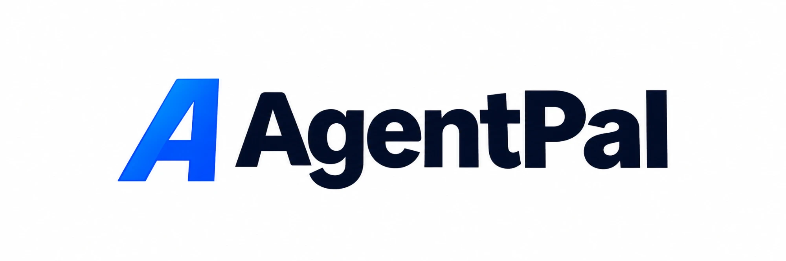
</p>

<p align="center">
  <b>The bank account for AI agents, with a human co-signer.</b><br>
  <sub>(A spending-allowance layer on the PayPal sandbox: AgentPal holds no money and is not a bank.)</sub><br>
  Let AI agents shop. Keep every dollar in your hands.<br><br>
  AI agents ask to pay. Deterministic rules and a human approve the <i>exact</i> terms. PayPal moves the money.<br>
  Only a PayPal-verified result counts as paid.
</p>

<p align="center">
  <a href="LICENSE"></a>
  
  
  
</p>

<p align="center">
  <a href="#-run-it-in-2-minutes">Quick start</a> ·
  <a href="#-connect-your-own-ai-agent">Connect an agent</a> ·
  <a href="#-how-it-works">How it works</a> ·
  <a href="docs/SELF_HOSTING.md">Self-hosting guide</a> ·
  <a href="docs/DEVELOPER_API.md">API</a> ·
  <a href="docs/SDK.md">Python SDK</a>
</p>

> **Sandbox only.** AgentPal runs against the **PayPal sandbox** with test money. It never touches
> real money, and it is not yet a production-ready payment service.

---

## 🎬 Demo video

[](https://youtu.be/NzxWO_GyRYg)

**Watch on YouTube:** https://youtu.be/NzxWO_GyRYg


---

## 🧑‍⚖️ Judges: try it in 60 seconds

1. Open the hosted sandbox dashboard: **https://agentpal-api.onrender.com/app/** (it may take a minute to wake up).
2. Sign in with the owner token from the Devpost testing instructions, or create your own private workspace with the invite code given there.
3. The Overview opens with a **Start here: 3-minute tour**. Or go straight to **Test Lab** → *Ask the AI agent to shop*, then **approve the exact terms**, pay on the PayPal sandbox page with the sandbox buyer from the testing instructions, and click **Capture**. The payment shows **Verified by PayPal read**.
4. Try a **$30** test request: a spending rule blocks it before any human sees it (the Test Lab agent's limit is $25).
5. In **Test Lab**, press the **Try an attack** buttons (over-limit, split purchase, changed terms, payee swap): each one is stopped by a rule, or by the exact-terms fingerprint, before any money can move.
6. Open any request: the approval screen shows a verdict, a price comparison and the payment journey. On a request awaiting approval, press **Counter** (or **Counter with this deal** when Channel3 found a cheaper offer): the agent's request is declined, and a replacement with your terms goes through every rule again and waits for your own approval.
7. In **AI Agents**, see the **Saver agent**: its suggestions feed and this month's scorecard (only PayPal-verified savings count).

Step-by-step scenarios, including a split purchase being blocked and a changed amount voiding an approval: **[docs/DEMO_SCENARIOS.md](docs/DEMO_SCENARIOS.md)**.

---

## 💡 Why AgentPal

AI agents are starting to do real work: buying supplies, paying freelancers, renewing software.
Today you either hand an agent your card and hope it never gets tricked by a fake shop or splits a
purchase to dodge a limit, or you do all the buying yourself. With AgentPal the agent does the
searching and preparing; hard rules filter every request; you review one clear screen, approve
the exact terms or counter with a better deal; and PayPal confirms the result.

**AgentPal is the missing middle layer.** Every agent gets its own identity, key and spending
allowance. It can find a product and ask to pay, but money only moves after deterministic rules
pass, an authenticated human approves the exact amount, payee and purpose, and PayPal confirms the
outcome.

## ✨ What you get

| | |
|---|---|
| 🪪 **Agent identities and keys** | Each agent has its own `apk_` key (shown once, stored as a hash) and only the permissions you grant. |
| 👛 **Wallets as allowances** | A monthly budget and a per-payment limit per agent. Wallets hold no money; they can be frozen instantly. |
| 🧱 **Deterministic rules first** | Budgets, hard limits, rolling windows, split-transaction detection, blocked domains, expiry. An over-limit request is refused before a human ever sees it. |
| ✍️ **Exact-terms approval** | You approve a SHA-256 fingerprint of amount, payee and purpose. Change anything and the approval is void. Agents can never approve. |
| 💳 **Real PayPal sandbox flows** | Orders v2 (payee-bound), buyer approval, capture, refunds, Payouts to freelancers, disputes (read), Transaction Search reconciliation, signed webhooks. |
| ✅ **Verified outcomes only** | A payment is "paid" only after an authenticated PayPal read or a signature-verified webhook. |
| 🔎 **Advisory intelligence** | Risk signals, a Channel3 market price check ("too good to be true?") and Kernel cloud-browser page checks. Advice only: it can never approve. |
| 🧾 **Audit timeline** | Every request has a timeline: who asked, which rule ran, who approved which terms, what PayPal confirmed. |
| 🔁 **Counter-offer ("Buy this instead")** | Besides approve and reject, the owner can counter: decline the agent's request and send back a replacement (your price, or the cheaper Channel3 deal). The counter approves nothing; the replacement runs every rule again and needs its own exact-terms approval. The bundled AI shopper follows a counter by itself: it waits for your approval of the replacement and pays it unchanged. Savings count only after PayPal verifies the capture (a sandbox payment to AgentPal's test account: no retailer order is placed, and the difference is between the agent's original proposed amount and the approved replacement amount). |
| 🐷 **Saver agents** | Hire a Saver with one manifesto: *"I exist to save you money. If I save you nothing this month, I retire myself."* It runs automatically while the server runs, scans the real Channel3 offers already recorded for requests awaiting your approval (no new provider calls) and suggests a counter. It can never approve or pay. Its monthly scorecard counts only PayPal-verified savings, and a month with none retires it (key revoked, history kept). Deterministic rules, no ML training. [docs/SAVER_AGENTS.md](docs/SAVER_AGENTS.md) |
| 🚦 **Clear approval screen** | Every request opens with an advisory verdict (Looks fine / Cheaper elsewhere / Check carefully / Blocked by rule), a price comparison against the best recorded offer when comparable market data exists, the payment journey from request to PayPal verification, and the exact terms with their fingerprint. |
| 🛑 **Freeze all agent spending** | One owner-only emergency stop freezes every wallet in your workspace, audited. |
| 🧪 **Test Lab** | Ask a built-in AI shopping agent to buy something, or create a test payment, and walk it through approval, PayPal checkout, capture and refund in the browser. |
| 🔐 **Bring your own keys** | Add PayPal, Channel3, Kernel, Groq and OpenRouter keys in the dashboard. Each is verified live, encrypted at rest and never shown again. |

## 📸 Screenshots

| Overview | Approve the exact terms |
|---|---|
| 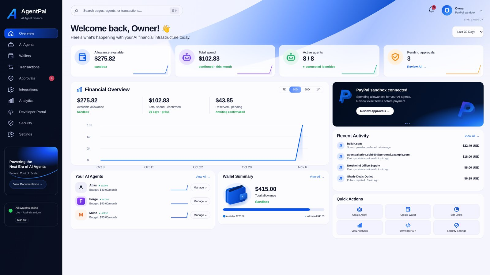 |  |
| **Risk signals and market check** | **Test Lab** |
| 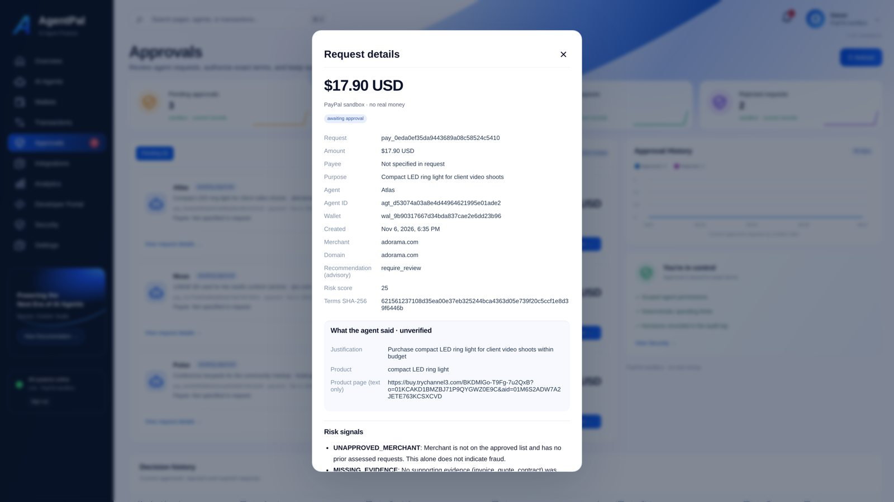 | 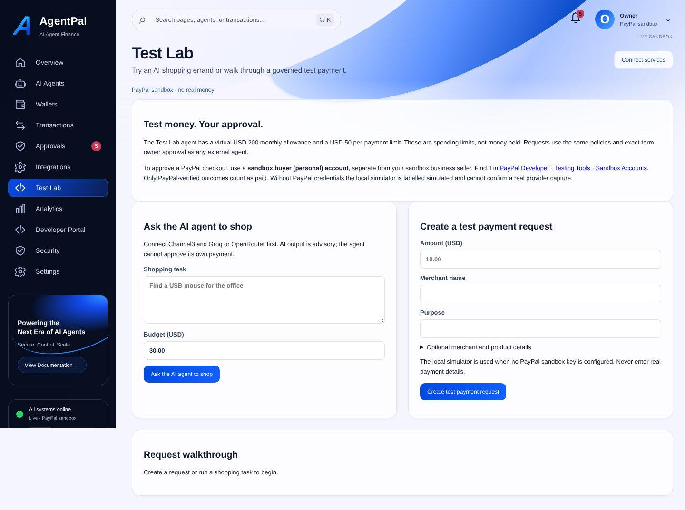 |
| **Connect your services** | **Agent key, shown once** |
| 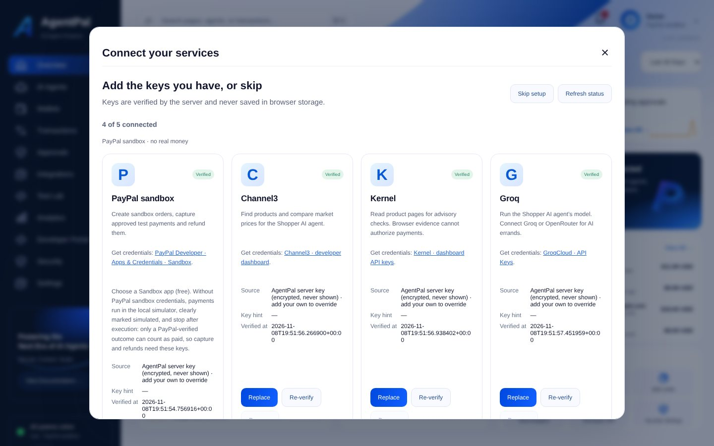 | 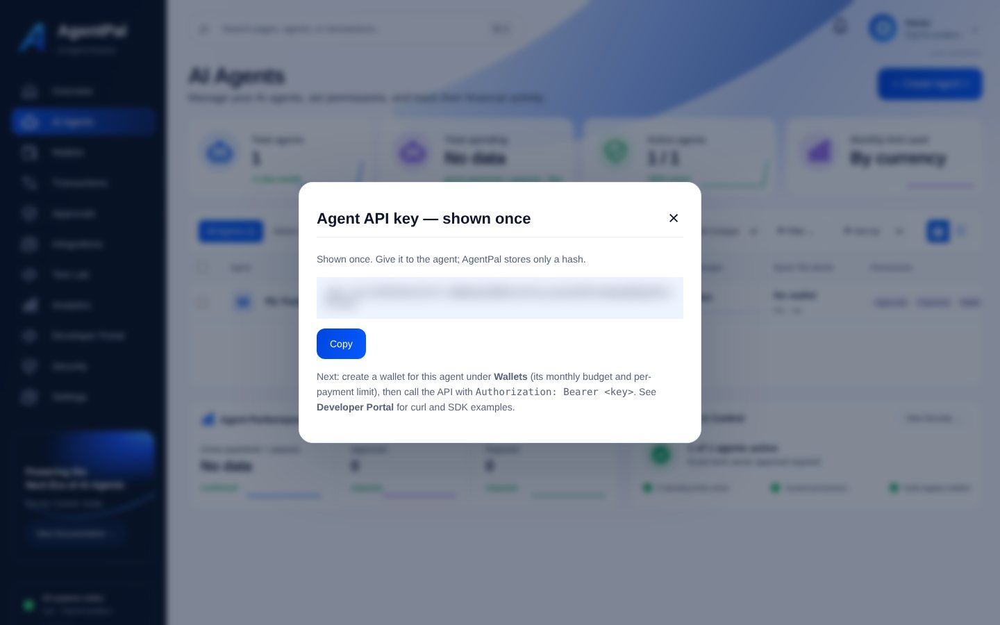 |
| **Transactions** | **AI agents** |
| 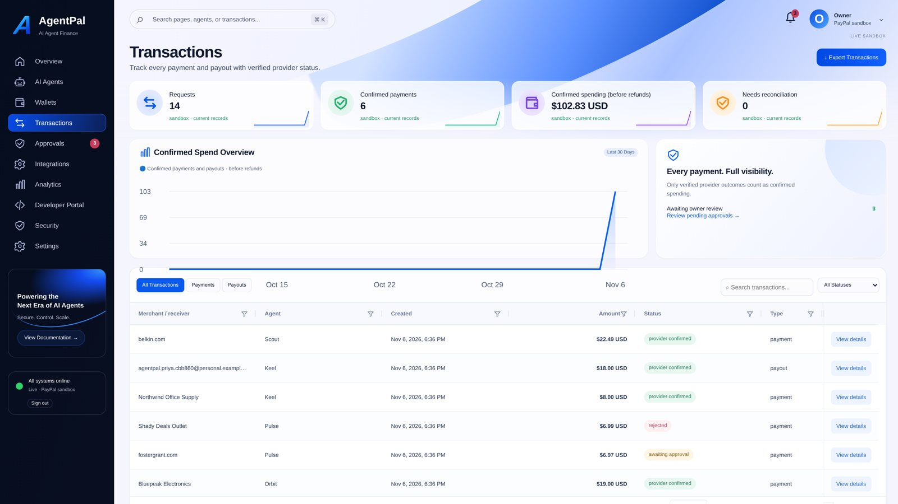 | 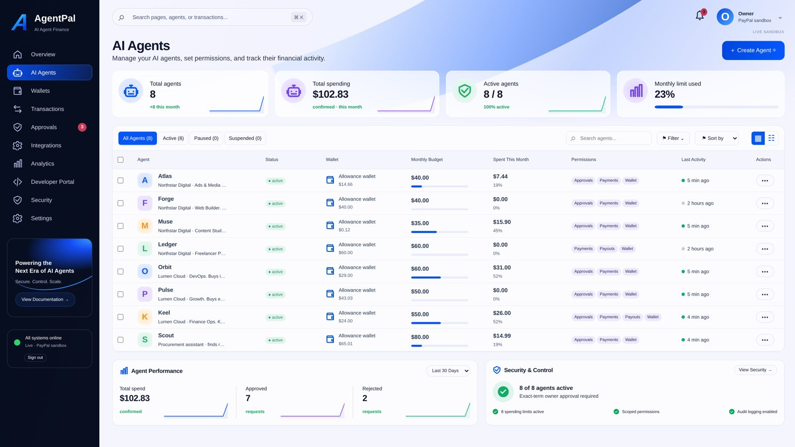 |

<p align="center">
  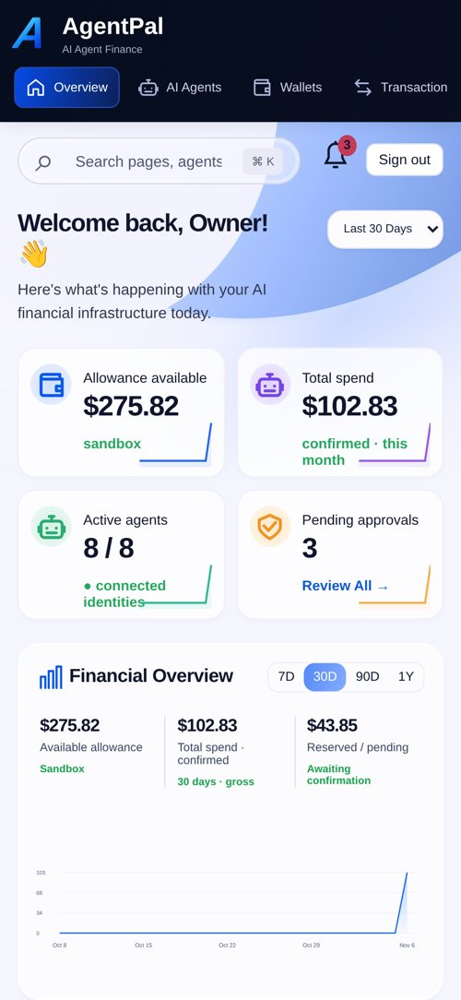
  &nbsp;&nbsp;
  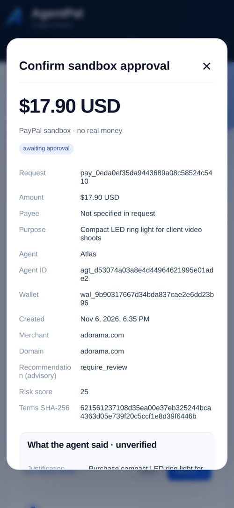
</p>

---

## 🚀 Run it in 2 minutes

You need **Python 3.11 or newer** and **git**. Works on macOS, Linux and Windows, on a laptop or a VPS.

```bash
git clone https://github.com/muhammadbilalbajwa156/agentpal.git
cd agentpal
python3 -m venv .venv
source .venv/bin/activate            # Windows: .venv\Scripts\activate
pip install -r requirements.txt
python -m agentpal start
```

The console prints two lines:

```
Dashboard: http://127.0.0.1:8000/app/
One-time setup code: <code>
```

1. **Open the dashboard** link in your browser.
2. **Create your workspace**: choose an owner id and a name, and paste the setup code.
3. **Save your owner access token** (`apo_…`). It is shown once; it is how you sign in.
4. **Connect your services**, or skip and add them later:

   | Service | What it powers | Where to get a key |
   |---|---|---|
   | **PayPal sandbox** (client id + secret) | Orders, capture, refunds, payouts, reconciliation | [developer.paypal.com](https://developer.paypal.com/dashboard/applications/sandbox) → Apps & Credentials → Sandbox |
   | **Channel3** | Product search and market price checks | [trychannel3.com](https://trychannel3.com) |
   | **Kernel** | Cloud-browser page checks | [onkernel.com](https://www.onkernel.com) |
   | **Groq** | The Test Lab AI shopping agent | [console.groq.com/keys](https://console.groq.com/keys) |
   | **OpenRouter** (optional) | Fallback model provider | [openrouter.ai/settings/keys](https://openrouter.ai/settings/keys) |

   Each key is checked with one read-only call to that provider before it is saved, then stored
   encrypted. Without PayPal keys, payments run in a clearly labelled local simulator and stop after
   execution, because only a PayPal-verified outcome may count as paid.
5. Open **Test Lab** and try a full payment.

Running it on a server, behind a reverse proxy, or with server-wide keys? See the
**[self-hosting guide](docs/SELF_HOSTING.md)**.

## 🤖 Connect your own AI agent

1. **AI Agents → Create agent**, click **Payment agent preset** and create it. Copy the `apk_…` key
   (shown once).
2. **Wallets → Create wallet** for that agent: a monthly budget and a per-payment limit.
3. Call the API from your agent:

```bash
curl -sS http://127.0.0.1:8000/v1/payment-requests \
  -H "Authorization: Bearer $AGENTPAL_AGENT_KEY" \
  -H "Idempotency-Key: hosting-plan-0001" \
  -H "Content-Type: application/json" \
  -d '{"amount": "19.99", "currency": "USD", "merchant_name": "Example Hosting",
       "merchant_domain": "example.com", "purpose": "Monthly hosting plan"}'
```

The request appears in **Approvals**. After you approve the exact terms, the agent calls
`POST /v1/payment-requests/{id}/execute`, the buyer approves on PayPal, and you capture.

Or use the async **Python SDK**:

```bash
pip install ./sdk/python
```

```python
import asyncio, os
from agentpal_sdk import AgentClient

async def main():
    async with AgentClient(base_url="http://127.0.0.1:8000",
                           credential=os.environ["AGENTPAL_AGENT_KEY"]) as agent:
        print(await agent.get_wallet())
        request = await agent.create_payment_request(
            amount="19.99", currency="USD", merchant_name="Example Hosting",
            merchant_domain="example.com", purpose="Monthly hosting plan",
            idempotency_key="hosting-plan-0001")
        print(request["status"])          # awaiting_approval: a human decides

asyncio.run(main())
```

More: **[Developer API](docs/DEVELOPER_API.md)** · **[SDK guide](docs/SDK.md)** ·
**[OpenAPI spec](docs/api/openapi.json)** · **[Postman collection](postman/v1.collection.json)**.
The dashboard's **Developer Portal** has the same examples, with downloads.

### Use it from any AI assistant (MCP)

AgentPal ships a dependency-free **MCP server**, so Claude, Cursor or any MCP client can use it as a tool:
`get_wallet`, `request_payment`, `get_payment_request`, `list_my_payment_requests` and
`execute_approved_payment`. There is deliberately **no approve tool**: an AI assistant can ask to pay,
but only the human owner can approve, in the dashboard.

```json
{"mcpServers": {"agentpal": {"command": "python", "args": ["-m", "agentpal.mcp_server"],
  "env": {"AGENTPAL_BASE_URL": "http://127.0.0.1:8000", "AGENTPAL_AGENT_KEY": "apk_..."}}}}
```

Setup for Claude Desktop, Claude Code and Cursor: **[docs/MCP.md](docs/MCP.md)**.

### Where AgentPal fits

PayPal's Agent Toolkit lets an agent create PayPal orders; Google AP2, OpenAI/Stripe ACP and Coinbase x402
define how agents express intent, check out or pay for resources. AgentPal is the **owner's control layer**
around agent spending: per-agent allowances, deterministic rules, a human co-signer for the exact terms, and
settlement that counts only when PayPal verifies it. It does not claim to implement those standards; the
honest comparison and an AP2 concept mapping are in **[docs/STANDARDS.md](docs/STANDARDS.md)**.

---

## 🧭 How it works

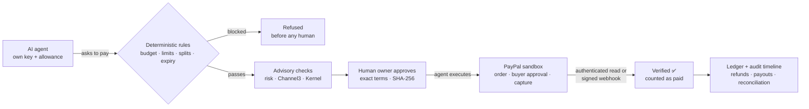

**The 12 principles AgentPal enforces:** AI is advisory only · deterministic limits always apply ·
no agent approves its own payment · human approval is authenticated · approval binds to exact
terms · any change invalidates it · only verified PayPal outcomes count · browser evidence is not
trusted blindly · outside messages are not consent · every agent has its own identity and scoped
permissions · every financial action is auditable · a model failure never bypasses the rules.

### Under the hood

* **API and ledger:** Python, FastAPI, SQLite. A versioned `/v1` API for agents and owners, an
  OpenAPI spec, a Python SDK and a generated Postman collection. The ledger reserves allowance on
  request, commits it only when PayPal confirms, and releases it on rejection or expiry.
  Idempotency keys prevent double payments.
* **Owner dashboard:** served by the API at `/app/` with a strict Content-Security-Policy and no
  third-party scripts; tables and charts use AG Grid and AG Charts (vendored).
* **Security:** owner tokens stored as salted SHA-256, agent keys as SHA-256 of 256-bit random values (never in plain text), per-agent capabilities, rate limits, host
  allow-list, loopback by default, optional TOTP for approvals, encrypted provider keys (Fernet),
  hash-locked dependencies.
* **Demo AI agents:** a Shopper agent and two autonomous companies (a marketing agency and a SaaS
  company) that plan with open-weight models on Groq. Render Workflows and Astropods adapters are
  included in the repo; the hosted demo runs the agents through the Test Lab and API. See [Shopper](docs/SHOPPER_AGENT.md) and [autonomous companies](docs/AUTONOMOUS_COMPANIES.md).

Deep dive: **[technical overview](docs/TECHNICAL_OVERVIEW.md)** · [architecture](docs/ARCHITECTURE.md) ·
[trust and ledger](docs/TRUST_AND_LEDGER.md) · [wallets](docs/WALLET_ARCHITECTURE.md) ·
[PayPal sandbox](docs/PAYPAL_SANDBOX.md) · [security audit](docs/SECURITY_AUDIT.md).

## 🧪 Tests

```bash
pip install -r requirements-dev.txt
python -m agentpal data            # synthetic data used by some tests
python -m pytest -q                # 3,900+ tests; live-provider tests skip without keys
cd frontend && npm test            # dashboard checks (Node 18+)
```

## 🗂️ Project structure

```
agentpal/        the service: API, policy engine, ledger, PayPal/Channel3/Kernel providers, demo agents
frontend/site/   the owner dashboard (plain JS, served at /app/)
sdk/python/      the async Python SDK (agentpal-sdk)
docs/            guides, API reference, architecture and audit reports
postman/         generated Postman collection and the Newman runner
config/          policy files (risk rules, demo spend policy)
tests/           unit, end-to-end and security tests
```

## 🙌 Built with

Built for the **PayPal AI Hackathon 2026**.

* **[PayPal](https://developer.paypal.com)**: Orders, Refunds, Payouts, Disputes, Transaction Search and Webhooks (sandbox)
* **[Channel3](https://trychannel3.com)**: product search and market price checks
* **[Render](https://render.com)**: hosting and Render Workflows for AI agents
* **Astropods**: hosted AI agents (Shopper and Company HQ)
* **[AG Grid](https://www.ag-grid.com)**: AG Grid and AG Charts in the owner dashboard
* **[Kernel](https://www.onkernel.com)**: cloud browser for merchant page checks
* **[Postman](https://www.postman.com)**: API testing and collections
* **AI models:** [Groq](https://groq.com) (gpt-oss-120b) and [OpenRouter](https://openrouter.ai) free models

## 🤝 Contributing and security

Issues and pull requests are welcome: see [CONTRIBUTING.md](CONTRIBUTING.md). Please report security
problems privately as described in [SECURITY.md](SECURITY.md).

## 📄 License

[MIT](LICENSE) © 2026 AgentPal contributors. Third-party notices: [frontend/THIRD_PARTY_NOTICES.md](frontend/THIRD_PARTY_NOTICES.md).
