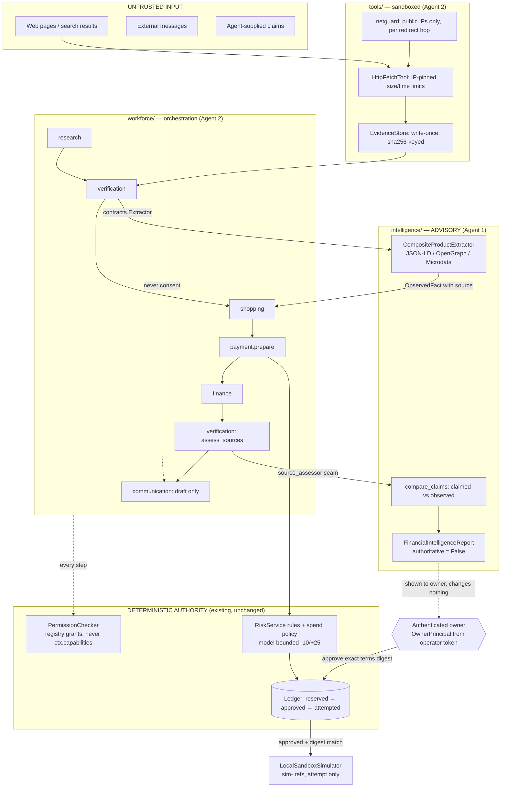

# AgentPal agent OS: how the parts cooperate

Lead (CTO) document, 2026-10-31. It ties together the work of the two specialist agents. Details are in their own documents:

- [INTELLIGENCE_ARCHITECTURE.md](INTELLIGENCE_ARCHITECTURE.md) and [INTELLIGENCE_TRAINING_PLAN.md](INTELLIGENCE_TRAINING_PLAN.md), by Agent 1;
- [WALLET_ARCHITECTURE.md](WALLET_ARCHITECTURE.md) and [WORKFORCE_ARCHITECTURE.md](WORKFORCE_ARCHITECTURE.md), by Agent 2.

**Status labels.** Each item carries exactly one label:

- **DESIGN ONLY**: documented, no code.
- **IMPLEMENTED — UNVERIFIED**: code exists, but no test exercises the path.
- **IMPLEMENTED — TESTED**: code plus passing tests.

Nothing here is production-ready, and nothing moves real money.

## 1. Layers and trust boundaries

The direction of authority is one-way. Model output, extracted facts and page content can **raise** caution, but none of them can approve, unblock or execute anything. Only two parties decide:

- the deterministic rules and the permission checker;
- an authenticated owner bound to the exact terms.

## 2. One purchase, end to end

| # | Who | What happens | Label |
|---|---|---|---|
| 1 | research agent | Fetches the owner's source URLs through `HttpFetchTool`. Private, loopback, metadata and redirect-to-private targets are refused. Pages are stored write-once by sha256. | IMPLEMENTED — TESTED |
| 2 | verification agent | Re-verifies the stored bytes against their hash, then runs Agent 1's `CompositeProductExtractor` through the `contracts.Extractor` protocol. Every fact is `observed`, with the URL, time and hash. An extractor crash yields `unavailable` facts. | IMPLEMENTED — TESTED (real extractor: `test_integration_agents.py`) |
| 3 | shopping agent | Proposes a price only from facts that meet all of these: **observed**, in the requested currency, and on the merchant's own registrable domain. Conflicting prices or a price over the cap halt the run. | IMPLEMENTED — TESTED |
| 4 | payment agent | Builds a `PaymentRequest`. The existing `RiskService` applies the rules and spend policy and **reserves** a hold. | IMPLEMENTED — TESTED |
| 5 | finance agent | Takes a snapshot of the virtual allowance. This is an internal budget record, not money. | IMPLEMENTED — TESTED |
| 6 | verification agent | Calls Agent 1's `assess_sources`, which compares claims with observations. The output is advisory only; a failure is recorded and changes nothing. | IMPLEMENTED — TESTED (real assessor) |
| 7 | communication agent | Drafts an owner notice, status `draft_not_sent`. **Sending is DESIGN ONLY.** | IMPLEMENTED — TESTED (draft) / DESIGN ONLY (send) |
| — | **GATE** | Status becomes `awaiting_owner_approval`. The orchestrator has no approve method and accepts no owner principal. | IMPLEMENTED — TESTED |
| 8 | owner | `WalletService.approve(OwnerPrincipal, request_id, terms)`. The principal is minted only from a mapped operator token. The approval binds to the SHA-256 of the exact terms, and the owner must match. | IMPLEMENTED — TESTED (in-process; there is **no HTTP endpoint** — DESIGN ONLY) |
| 9 | payment agent | `resume_after_approval` re-checks the digest and the wallet-recorded approval. `LocalSandboxSimulator` records an **attempt** with a `sim-` reference. Nothing records a "completed" outcome (rule 7: only a verified provider outcome counts). | IMPLEMENTED — TESTED |

## 3. The 12 security rules: where each is enforced

| Rule | Enforcement | Evidence |
|---|---|---|
| 1. Models are advisory | The orchestrator bounds the model to −10/+25 and can only add review. `FinancialIntelligenceReport.authoritative` is constant False. `report.advisory` is never read by any decision. | `test_intel_report`, `test_workforce_orchestrator` (an assessor that returns `approve: True` has no effect) |
| 2. Deterministic hard limits | Existing spend policy and ledger (unchanged); the wallet only calls into them. | existing budget/invariant suites, `test_wallet_service` |
| 3. No self-approval | `require_owner` checks `isinstance(OwnerPrincipal)`, else `SEPARATION_OF_DUTIES`. No agent can hold an owner principal. | `test_wallet_permissions`, `test_wallet_service` |
| 4. Authenticated human approval | `owner_principal_from` accepts only mapped operator tokens. | `test_wallet_service` |
| 5–6. Binding to exact terms; any change invalidates | `ApprovalTerms` SHA-256, checked at approve and again at execute. | `ApprovalTermsMismatch` tests |
| 7. Only verified provider outcomes count | The wallet never calls `record_payment_outcome`; the sandbox records attempts only. | AST test + spy test |
| 8. Browser evidence not automatically trusted | `SourceEvidence` proves retrieval, not truth. The lead **removed** Agent 1's exception that let a consistent page clear missing-evidence signals (`3535bbb`). | `test_consistent_observation_does_not_clear_missing_evidence` |
| 9. External messages are not consent | Notices are drafts; no inbound channel can approve. | `test_workforce_orchestrator` (notice says "not consent") |
| 10. Isolated identities, scoped permissions | Per-agent registry, a role ceiling, and the owner matched on every check. `ctx.capabilities` is ignored. | `test_wallet_permissions` (forged context) |
| 11. Auditable | Every permission decision goes to `wallet_permission_audit`; the existing ledger audit is unchanged. | `test_wallet_permissions` |
| 12. Model failure does not bypass rules | An assessor or extractor exception is recorded and the gate still holds. | `test_assessor_failure_is_recorded_and_the_gate_still_holds` |

## 4. Known gaps (not hidden)

- **Not built (DESIGN ONLY):** HTTP API for owner approval, real search provider, real browser automation, message sending, and any real payment provider (PayPal etc.).
- **Owner identity is an in-process object.** It is minted from an operator token; there is no per-owner login, MFA or step-up.
- **No cross-database atomicity.** The wallet DB and the assessment DB are separate. A crash between them fails closed, and the owner re-approves.
- **Network residual risk.** The DNS-to-connect window is closed by IP pinning. A compromised resolver or proxy can still serve false content; that is why content is never trusted (rule 8).
- **Synthetic data.** Agent 1's `intel-sft-1` data (416 examples) is synthetic and labelled by its own generator (circular). It is not evidence of real-world accuracy, and no model was trained on it today. The pinned run-2 model is unchanged.
- **Open findings carried over:** SEC-13, SEC-15 and SEC-16 (see [AUDIT_LEDGER.md](AUDIT_LEDGER.md)).

## 5. Dev-Infra v1 integration (2026-10-31)

The sections above describe the earlier workforce milestone. The developer platform
now provides the HTTP owner-approval and sandbox-provider path for external agents.
**IMPLEMENTED — TESTED:** `python -m agentpal serve --platform` mounts `/v1` with
`platform.wiring.build_platform()`. Plain `serve` retains the legacy assessment API.
There is no frontend, model change or live-money path.

The factory builds a durable `OwnerIdentityService`, `AssessmentStore(strict_execution=True)`,
`WalletService(require_authenticated_owner=True, identity=...)`, and
`PaymentLifecycleService`. Owner sessions are revalidated at approval; approval binds
the exact terms digest and is consumed once by execution. The approval adapter delegates
to WS1. The lifecycle adapter passes `provider.name` to WS1 and resolves reconciliation's
agent from persisted platform metadata, checking the corresponding ledger request.
`ProviderEventSink` is the WS1 lifecycle service itself. Reconciliation HTTP GET remains
a read of status and provider references; the gateway's explicit `reconcile()` performs
the provider status query.

`AGENTPAL_DB_PATH` selects the ledger. By default identity and wallet files append
`.identity.db` and `.wallet.db` to that path; override them with
`AGENTPAL_IDENTITY_DB_PATH` and `AGENTPAL_WALLET_DB_PATH`. Bootstrap an owner using
`python -m agentpal.identity --db <identity-path> create-owner --owner-id <owner-id>`
and `issue-token --owner-id <owner-id>`. Tokens are shown once; keep them out of git.
In-memory stores are independent connections for tests only.

Cross-store lock order is **wallet before ledger** whenever preparation nests them.
Identity checks finish before decisions, ledger transactions finish before wallet audit
writes, and provider network calls run after ledger commits. Never acquire wallet or
identity locks while holding a ledger transaction. The factory prebuilds the strict wallet
service before requests so lazy preparation does not run consistency checks inside its
wallet transaction. All three database files must be distinct (including symlinks and
hard links). Startup recovers ambiguous pending attempts to `reconciliation_required`
and checks both financial stores; mismatches refuse startup. There is no atomic commit
across databases; WS1 consistency checks and WS2 idempotent preparation recovery fail closed.

With `PAYPAL_SANDBOX_CLIENT_ID` and `PAYPAL_SANDBOX_CLIENT_SECRET`, execution uses
`PayPalSandboxProvider`; `PAYPAL_SANDBOX_WEBHOOK_ID` enables its webhook verification.
Any nonempty `PAYPAL_SANDBOX_*` setting requires valid sandbox configuration; partial
credentials refuse startup. Otherwise a `LocalSandboxSimulator` adapter supplies
`sim-` order references and `provider_pending`, never completion. It cannot verify capture,
status reads or webhooks. Only a verified `ProviderEvent` applied through the lifecycle
sink can confirm a payment. **BLOCKED:** live PayPal sandbox validation without credentials.

Checks: `make openapi-check`, `make postman-generate`, `make postman-check`,
`make postman-newman POSTMAN_MODE=legacy` or `POSTMAN_MODE=v1`.
`make postman-sync` is a dry run, requires `POSTMAN_API_KEY`, and never applies remote
changes. The Newman runner bootstraps a throwaway owner in an isolated identity DB,
registers agents and virtual USD wallets through HTTP, then runs the security folder
against an actual loopback CLI server. Reports redact all runtime credentials.
