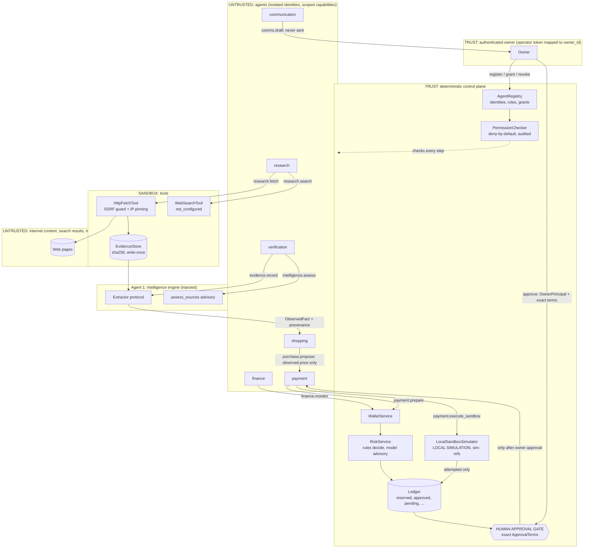

# Workforce architecture: registry, permissions, tools, orchestration

Status: DEMO / SANDBOX ONLY.

Code:
- `agentpal/workforce/` (roles, orchestrator);
- `agentpal/wallet/` (registry, permissions; see WALLET_ARCHITECTURE.md);
- `agentpal/tools/` (fetch, search, evidence store).

Tests: `tests/test_workforce_*.py`, `tests/test_tools_*.py`, `tests/test_wallet_*.py`. All are offline: `httpx.MockTransport` and fake resolvers.

## 1. Flow and trust boundaries



Rules the diagram encodes:

- Agents never cross into the control plane except through `PermissionChecker` and `WalletService`.
- The only edge into the gate that opens it comes from the owner.
- The simulator only produces `attempted`. Completed requires a verified provider outcome, which is not implemented.

## 2. Roles → capabilities (`workforce/roles.py`)

| Role | Ceiling (most an owner can grant) | Default at registration |
|---|---|---|
| research | research.search, research.fetch, wallet.read | = ceiling |
| shopping | purchase.propose, research.search, research.fetch, intelligence.assess, wallet.read | = ceiling |
| finance | finance.monitor, wallet.read, intelligence.assess | = ceiling |
| communication | comms.draft, comms.send_approved | comms.draft only (sending is opt-in) |
| verification | evidence.record, research.fetch, intelligence.assess | = ceiling |
| payment | payment.prepare, owner.request_decision (asks; never decides), payment.execute_sandbox, wallet.read | = ceiling |
| external (developer-connected agent, `/v1`) | wallet.read, research.search, research.fetch, payment.prepare, owner.request_decision, payment.execute_sandbox | wallet.read, payment.prepare, owner.request_decision (research and sandbox execution are opt-in) |

Properties, checked at import time and in tests:

- No role holds both `purchase.propose` and `payment.execute_sandbox`.
- Money capabilities exist only in the payment and external roles; external sandbox execution requires an explicit owner grant.
- No capability approves anything. Approval needs an `OwnerPrincipal`, which no agent is.

## 3. Registry and permission model

- **Registry** (`wallet/registry.py`): every mutation needs an `OwnerPrincipal` and acts only on that owner's agents. A grant outside the role ceiling is refused and audited. Grants recorded under another owner do not count.
- **`PermissionChecker.check(ctx, capability, resource_owner_id=None, resource_agent_id=None, action="")`** allows only if:
  - the agent is registered and active;
  - the context's owner and role equal the registry's;
  - the capability is granted and inside the ceiling;
  - the resource belongs to the same owner (and agent, if given).
- **Lead decision 1:** `ctx.capabilities` is **advisory** and never read. A forged `AgentContext` with every capability is denied (tested).
- **Audit:** every decision is written to `wallet_permission_audit` with a code (`ALLOWED`, `UNKNOWN_AGENT`, `OWNER_MISMATCH`, `ROLE_MISMATCH`, `AGENT_SUSPENDED`, `NOT_GRANTED`, `CROSS_OWNER`, `OTHER_AGENT`, `INVALID_CONTEXT`) and an action (e.g. `tool:http_fetch`, `wallet.execute_sandbox`).
- **Capabilities never bypass policy:** tools touch no wallet or ledger, and payment capabilities still go through the RiskService, the ledger and the human gate.

## 4. Tool interface (`tools/`)

All tools implement `contracts.Tool` (`name`, `required_capability`, `run(ctx, **params) -> ToolResult`). Each takes an injected permission authority and fails closed (`not_permitted`) without one.

### `HttpFetchTool` (research.fetch)

- **Targets:** https only (http only with `allow_http=True`); default port; no userinfo; URL ≤ 2048 characters.
- **`netguard.vet_url`** refuses:
  - private, loopback, link-local and metadata addresses (169.254.169.254, fd00:ec2::254);
  - CGNAT, multicast, reserved, unspecified and benchmarking ranges;
  - ULA and site-local addresses;
  - IPv4-mapped, NAT64, 6to4 and Teredo forms;
  - numeric host obfuscations (`2130706433`, `0x7f.1`, `127.1`, `017.0.0.1`);
  - local-only names (`localhost`, `*.local`, `*.internal`, single-label names);
  - any host where *any* resolved address is non-public.
- **IP pinning:** each hop connects to the vetted address. The original `Host` header and the TLS SNI and certificate name (`sni_hostname` request extension) are kept, so a second DNS answer cannot redirect the connection.
  - Verified manually against a local TLS server: the correct name connects; a name the certificate does not cover fails TLS; cookies are not carried across a redirect.
  - In the suite, the mock transport asserts the pinned IP, the Host header and the SNI.
- **Per hop:**
  - the guard and the owner origin allow-list run again on every redirect hop;
  - each hop uses a fresh client (no cookie jar), `trust_env=False` (no env proxy or .netrc), and no auth headers.
- **Limits:**
  - `max_redirects` (5);
  - a per-operation timeout plus an overall deadline across hops (10 s);
  - `max_bytes` of decoded body (2 MB), checked against the declared length and while streaming, so a decompression bomb is cut off.
- **Output:**
  - `SourceEvidence(url, final_url, retrieved_at UTC, http_status, content_sha256, method="http_fetch")`;
  - the bytes go to `EvidenceStore`;
  - **no facts**.
  - HTTP ≥ 400 and transport errors are explicit failures.

### `WebSearchTool` (research.search)

- The default provider is `NotConfiguredSearchProvider`, which returns `not_configured` and states what is needed:
  - choose a provider (Brave, Bing, SerpAPI or Google PSE);
  - store its API key as a secret;
  - inject a `SearchProvider`.
- Hits are **leads**: https-only `SourceEvidence(method="search_result")` with no facts. The research agent must fetch the original source.

### `EvidenceStore`

- Content-addressed by SHA-256 under `data/evidence/` (git-ignored) by default.
- Write-once and atomic; re-verified on read; ids are validated (no path escape); size-capped.

### Residual DNS-rebinding and network risks

These are documented honestly:

- **Custom transports:** pinning relies on httpx and httpcore honouring the `sni_hostname` extension (httpcore ≥ 0.17; installed 1.0.9). A custom injected transport that ignores it could verify TLS against the IP; production must use the default transport.
- **Opt-in http:** with `allow_http=True` there is no TLS. A pinned IP still prevents rebinding, but content integrity is not protected.
- **Partial resolution:** only the first vetted address is used, and every resolved address must be public.
- **Resolver trust:** the system resolver is trusted to return the addresses the OS would use. A compromised local resolver is out of scope.
- **No egress proxy:** an egress proxy is not supported (`trust_env=False`). Behind a mandatory proxy, the proxy re-resolves names, so the guard would need to run at the proxy instead.
- **Untrusted content:** the content is untrusted data. Nothing in it is executed, and prompt-injection text is inert (tested). Extractors must still treat it as hostile.

### Browser (Playwright): DESIGN ONLY

Requirements for a browser tool:

- a separate container or VM with no access to the host network;
- an egress proxy that applies the same `netguard` rules to every request, including subresources and WebSockets;
- a fresh profile per task (no cookies or credentials);
- no downloads, file:// URLs or extensions;
- a navigation and time budget;
- a screenshot plus DOM bytes stored as evidence (`method="browser"`);
- the same capability gate.

## 5. Orchestration foundation (`workforce/orchestrator.py`)

**Built-in flow:** `Orchestrator.run_purchase_research(PurchaseIntent, Team) -> TaskReport`.

1. **Team validation:** every agent belongs to the intent's owner, has the role of its slot and is active. Otherwise `OrchestrationError`.
2. **research:** fetches the owner's source URLs (and searches, when configured).
3. **verification** (`evidence.record`): re-verifies each stored object and runs the injected extractors through `contracts.Extractor`.
   - An extractor exception becomes an `unavailable` fact.
   - An observed fact that does not cite *this* source (same URL and sha) is dropped.
4. **shopping** (`purchase.propose`) proposes only from an **observed** price in the requested currency on the merchant's own registrable domain. It stops when:
   - there is no such price;
   - there are conflicting prices;
   - the price exceeds the owner's task cap.
5. **payment** (`payment.prepare`): `WalletService.prepare_payment` → RiskService. A `block` result or no reservation stops the flow.
6. **finance** (optional, `finance.monitor`): allowance snapshot after the hold.
7. **verification** (`intelligence.assess`, optional): the injected `source_assessor(req, pages, extractor)` (Agent 1's `intelligence.research.assess_sources`). Its output is shown to the owner and changes nothing; its failure is recorded.
8. **communication** (optional, `comms.draft`): an owner notice draft, never sent. It states that replies are not consent.
9. **GATE:** `status = awaiting_owner_approval`.

**Continuing past the gate:** `resume_after_approval(report)` calls `WalletService.execute_sandbox`. It succeeds only if an authenticated owner approved exactly the prepared terms through the wallet. Otherwise the task stays at the gate.

**The orchestrator has no approval path:**
- it has no `approve`, `decline` or `record_owner_decision` call and no `OwnerPrincipal` parameter (an AST test checks this);
- injected page text or advisory output claiming approval has no effect (tested).

**Integration point for Agent 1:**

```python
Orchestrator(registry, checker, wallet, evidence_store, fetch_tool=HttpFetchTool(...),
             extractors=[CompositeProductExtractor()],
             source_assessor=intelligence.research.assess_sources)
```

With exactly one extractor, that extractor is passed through unchanged to the assessor. With several, they are chained behind one `Extractor`.

## 6. Status

| Item | Status |
|---|---|
| Role table, ceilings, defaults | IMPLEMENTED — TESTED |
| Registry + deny-by-default permission check + audit | IMPLEMENTED — TESTED |
| `HttpFetchTool` + `netguard` + IP pinning | IMPLEMENTED — TESTED (offline mocks); TLS pinning also verified manually against a local TLS server, not in the suite |
| `WebSearchTool` (not configured) + provider interface | IMPLEMENTED — TESTED |
| `EvidenceStore` | IMPLEMENTED — TESTED |
| Orchestrator purchase flow, human gate, resume | IMPLEMENTED — TESTED |
| Agent 1 seam (extractors + `source_assessor`) | IMPLEMENTED — TESTED with fakes; UNVERIFIED with Agent 1's real code |
| Communication sending (email/WhatsApp), inbound replies | DESIGN ONLY (drafts only; replies are never consent) |
| Browser tool (Playwright) | DESIGN ONLY |
| Live search provider | DESIGN ONLY (needs a provider + API key) |
| Persistent task state / multi-step scheduling | DESIGN ONLY (a `TaskReport` lives in memory) |
